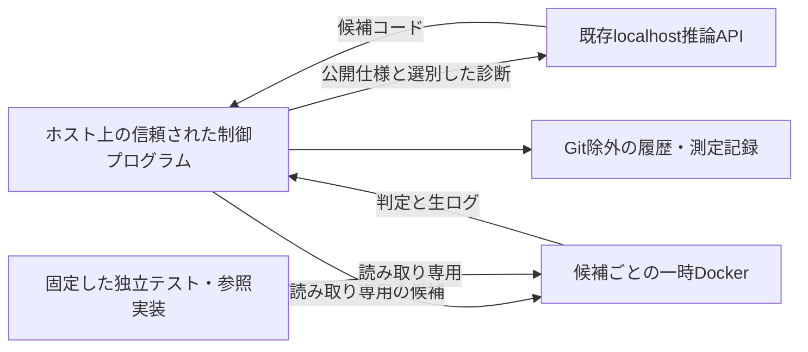

# 独立検証・自動修正ループPoC

既存のQwen3-Coderサーバーへlocalhost APIで課題を送り、固定した独立テストで判定する。
対象は `evaluation/coder/tasks.json` のコード課題7件。初回を新規生成し、不合格の場合だけ最大3回修正する（合計最大4候補）。合格時はそこで停止する。
推論サーバーの設定・コンテナ・ホストパッケージは変更しない。Python標準ライブラリと既存Dockerイメージだけを使用する。



## 隔離の確認

公式資料の [Docker security](https://docs.docker.com/engine/security/)、[seccomp](https://docs.docker.com/engine/security/seccomp/)、[resource constraints](https://docs.docker.com/engine/containers/resource_constraints/) を確認し、既存のseccomp・AppArmor・cgroup v2環境で実測する。

| 項目 | PoCの実行設定 |
|---|---|
| イメージ | 既存 `project-kiss-code-eval` のID固定。新規パッケージ不要 |
| ユーザー | 非rootの数値UID/GID |
| 通信・公開ポート | `network=none`、公開ポートなし |
| GPU・Dockerソケット | 渡さない |
| rootfs・入力・テスト | 読み取り専用。ホストへの書込みマウントなし |
| 一時領域 | `/work` 256MiB（バイナリ実行用exec・nosuid・nodev）、`/tmp` 256MiB |
| 権限 | capability全削除、no-new-privileges、Docker標準seccomp・AppArmor |
| RAM・swap | RAM 2GiB、swap追加なし |
| CPU・PID | 4 CPU、128プロセス |
| 時間 | コンパイル/実行の各コマンド30秒、候補コンテナ全体120秒 |
| 出力 | 各コマンド64KiB、コンテナ全体1MiB |
| ファイル | 1ファイル32MiB、core dump禁止、Dockerログdriverなし |
| 後処理 | 作成した一時コンテナの正確なIDだけを終了・除去 |

事前プローブでは非root、CapEff=0、NoNewPrivs=1、Seccomp=2、GPU/socketなし、外部接続不可、RO入力、実行可能なtmpfs、cgroup/RLIMIT値を確認する。
さらにsleepの時間超過、大量出力、64MiB制限下の128MiB割当によるOOMを確認する。
制御側の停止処理も検証対象とする。初期実装で見つかった出力量制限時の終了競合は、Docker接続を先に閉じてから当該コンテナを停止する方式で修正した。
Dockerの既定tmpfsがnoexecとなるため、PoC専用 `/work` のみexecを明示した。既存ホスト・推論サーバーのセキュリティ設定は変更しない。

## 独立した合否判定

既存のC/C++・POSIX・Rust・AArch64/NEONのテストソースと参照計算をそのまま使用する。
`runner.py` は単一課題向けのコンパイル/実行アダプターで、既存の `run-tests.py` やテストソースは変更しない。
候補のみを先にコンパイルし、次に独立テストとリンクして実行する。既存と同じASan/UBSan、Rust overflow-checks/unsafe禁止、Armv8-A/QEMU、命令検査を使用する。
合格はコンパイル・実行の成功と検証完了表示を満たした場合に限る。タイムアウト、出力超過、OOM、形式不正も合格にしない。
信頼されたランナー自体が壊れた場合はモデルの不合格と混同せず、実行を中止する。

事前に既知の正しい実装7件と意図的な誤実装7件でアダプターを確認する。
本実行の開始時にテスト・課題・ランナーのSHA256を固定し、各候補の前後と終了時に一致を確認する。
モデル出力に合わせたテスト変更や手修正は行わない。

## モデルへ返す情報

- 公開された元の課題仕様、モデル自身の過去のコード。
- 候補だけのコンパイル段階で出た、候補ファイルのエラー/警告/注記。ソース行の抜粋は渡さない。
- 実行失敗は「独立した結果/契約検査の不一致」「メモリ安全性/UB違反」「境界検査中の不正アクセス」「時間/資源超過」等の分類。
- テスト側のリンクエラーは要求インターフェース確認の案内に要約する。

テストソース、assert式、入力ケース、期待値、参照実装、実行の生stdout/stderrはAPIへ返さない。
フィルターのテストでは秘密の期待値を含むassertやstderrを与え、候補コンパイル診断だけが残ることを確認する。
フィルターは診断を限定するため、修正に必要な情報が不足して3回で直らない可能性も結果として記録する。

## 実行と履歴

```sh
# 初回の準備。既存の報告ファイルは上書きしない
python3 scripts/check-repair-isolation.py logs/repair-isolation-exec.json
python3 scripts/check-repair-runner.py
python3 -m unittest discover -s evaluation/coder/repair -p test_feedback.py

# 7課題の新規生成と最大3回の修正
python3 scripts/repair-coder.py
```

事前確認ファイルが既にある場合、再確認時は既存ファイルを別名で保存してから実行する。
本実行は `logs/repair/<UTC run-id>/` に毎回新しいディレクトリを作成する。
各課題の `attempt-0` が初回、`attempt-1`〜`attempt-3` が修正候補。

- `api.json`: 送信した全メッセージ、生応答、API時間、usage。
- 候補ソース: コードブロックをそのまま抽出したもの。
- `sandbox.json`: 実行した隔離条件、終了/OOM状態、出力量制限、全体時間。
- `verification.json`: 生のコンパイル・サニタイザ・独立テスト結果（ローカル保存のみ）。
- `feedback.txt`: モデルへ返すために選別した情報。
- `result.json` / `summary.json`: 各候補と課題の合否、修正回数、トークン、所要時間。
- `manifest.json` / `report.json`: 固定ハッシュ、環境、初回/最終合格数、全履歴、サーバー変更なしの確認。

トークンは各API応答のusageを合計し、修正時に再送した会話も含める。入力・出力を区別して記録する。
各候補の開始前に全体の30分予算を確認し、APIは1回180秒で打ち切る。
生成コード・モデル・生ログはGit管理しない。

## 範囲と限界

最終合格は固定した独立テストへの合格であり、全入力での形式的な正しさの証明ではない。
AArch64はQEMUでの検証であり、実機での性能・全ABI条件を保証しない。
Dockerは共有カーネルによる隔離で、このPoCは上記の制限を実機で検証する。敵対的なネイティブコードに対するVM相当の隔離や、採点器への意図的な攻撃への完全な耐性は対象外。
